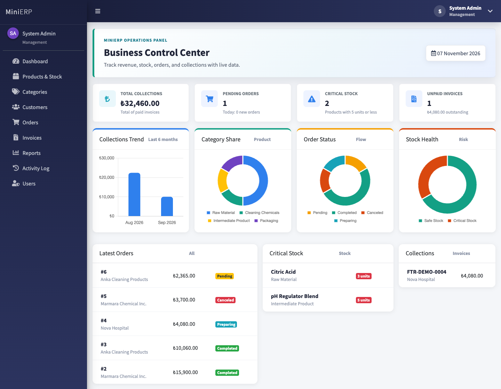
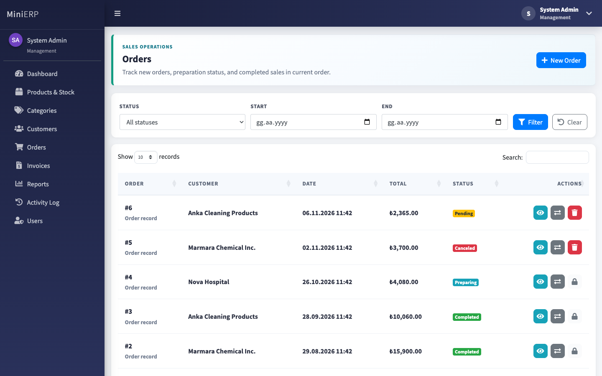
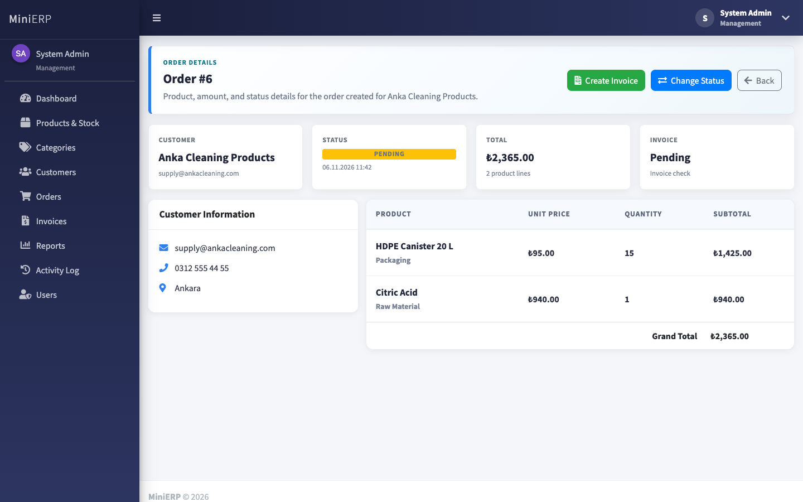
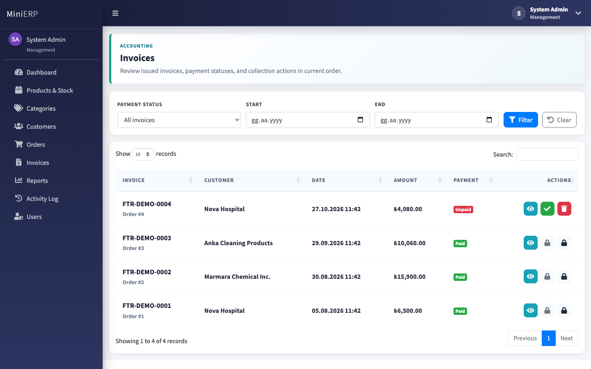
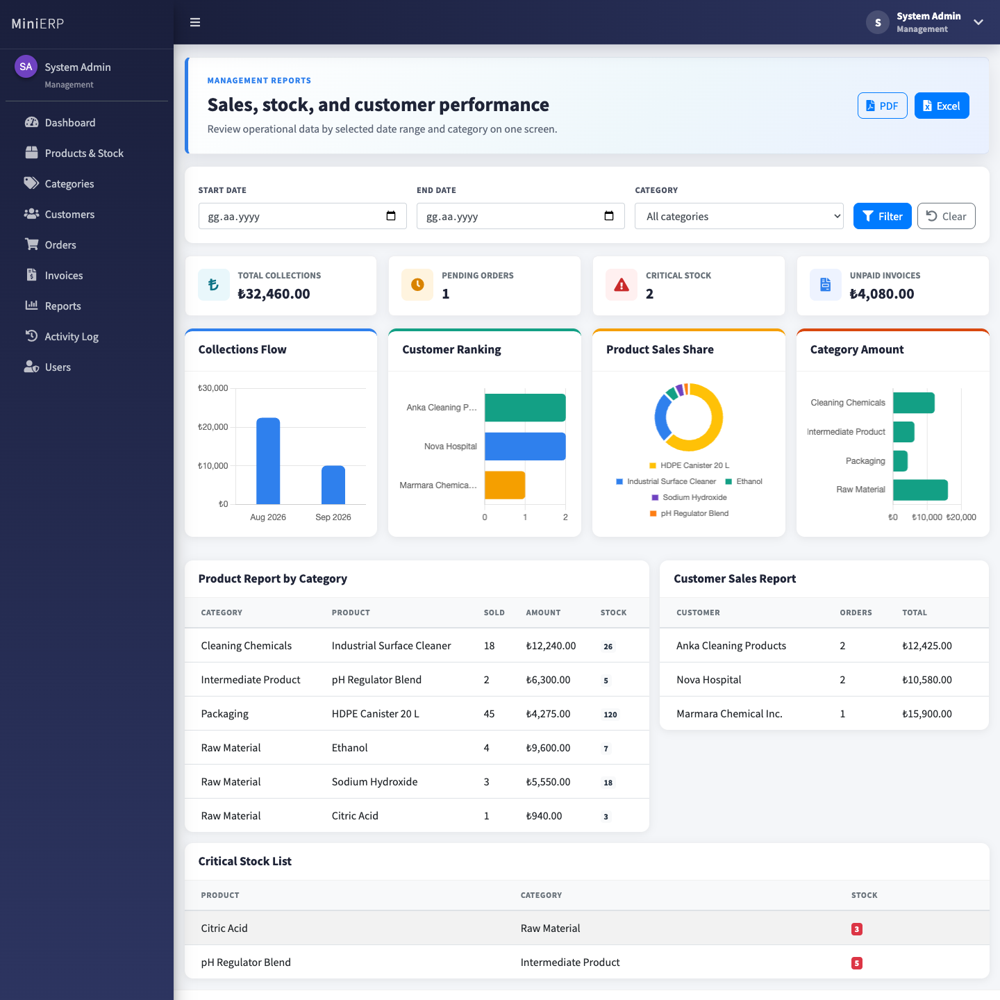
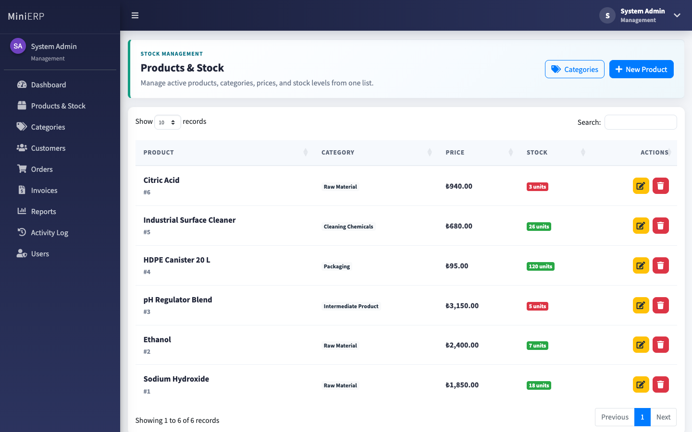
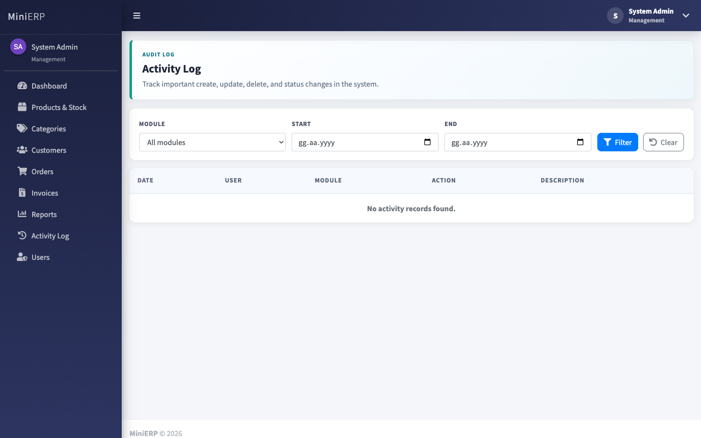

# MiniERP

[](https://github.com/AhmetTaha1/MiniERP/actions/workflows/ci.yml)


A small ERP for a B2B trading or production business. It covers products and stock, customers, orders, invoicing, management reports, role-based access, and an audit trail. It is built with **ASP.NET Core MVC**, **Entity Framework Core**, and **PostgreSQL**.



## Features

| Module | What it does |
| --- | --- |
| **Dashboard** | KPIs (collections, pending orders, critical stock, unpaid invoices), a monthly collections chart, category, order status and stock health charts, plus the latest orders and open invoices |
| **Products & Stock** | Product CRUD with soft delete, critical stock threshold, and inline creation of new categories |
| **Categories** | Categories linked to products by foreign key. Renaming updates every product. Categories with product history cannot be deleted |
| **Customers** | Customer CRUD with unique emails. Customers with order history are protected from deletion |
| **Orders** | Multi-line orders with stock reservation and a status workflow (Pending → Preparing → Completed / Canceled). Canceling returns stock |
| **Invoices** | One invoice per order, sequential numbers (`FTR-2026-000001`), paid/unpaid tracking, and PDF export |
| **Reports** | Filters by date range and category. Sales by product, category and customer, plus a critical stock list. Export to **Excel (.xlsx)** and **PDF** |
| **Activity Log** | Audit trail of every create, update and delete, with user, module and date filters |
| **Users & Roles** | ASP.NET Core Identity with five roles, account lockout after failed logins, and admin-managed users |

## Screenshots

| Orders | Order detail |
| --- | --- |
|  |  |
| **Invoices** | **Reports** |
|  |  |
| **Products** | **Activity log** |
|  |  |

## Business rules

These rules are enforced on the server, with database constraints where possible, not only in the UI:

- **Stock is reserved when an order is placed** and returned when the order is canceled or a non-invoiced order is deleted.
- **No overselling under concurrency.** `Urun.StokAdedi` is an EF Core concurrency token. If two requests sell the same product at the same time, the second save fails instead of pushing stock below zero. Order creation, status changes and deletes run inside a database transaction together with their audit log entry.
- **Order state machine.** `Pending → Preparing → Completed`, and `Pending/Preparing → Canceled`. Completed and Canceled are final. An order can only be completed once its invoice exists **and** has been paid.
- **Record integrity.** Customers with orders, invoiced or completed orders, paid invoices, and products in active orders cannot be deleted. Foreign keys use `ON DELETE RESTRICT`, so the database enforces this as well. Products are deactivated (soft delete) so historical orders keep their lines.
- **Revenue** in the dashboard and reports comes from **paid invoices**. Sales figures come from order lines and **exclude canceled orders**.

## Roles

| Role | Access |
| --- | --- |
| **Admin** | Everything, including user management |
| **Sales** (`Satis`) | Customers, creating orders, order status |
| **Stock** (`Stok`) | Products and categories |
| **Accounting** (`Muhasebe`) | Invoices and payments; read-only access to orders |
| **Management** (`Yonetici`) | Reports and activity log; read-only access to orders |

## Getting started

### Option 1: Docker (recommended)

```bash
docker compose up --build
```

Open <http://localhost:8080>. The database is migrated and filled with demo data on first start.

### Option 2: Run locally

Requirements: [.NET 9 SDK](https://dotnet.microsoft.com/download) and PostgreSQL 14 or newer.

```bash
git clone https://github.com/AhmetTaha1/MiniERP.git
cd MiniERP

# Point the app to your PostgreSQL instance (stored outside the repo)
dotnet user-secrets set "ConnectionStrings:DefaultConnection" \
  "Host=localhost;Port=5432;Database=MiniERPDb;Username=postgres;Password=<your-password>" \
  --project src/MiniERP

dotnet run --project src/MiniERP
```

Pending migrations are applied automatically at startup. To turn this off, set `Database:MigrateOnStartup=false` and apply migrations yourself with `dotnet ef database update --project src/MiniERP`.

### Demo accounts

> These accounts exist **only for local and demo use**. They are created from configuration (`Seed:*`) and are shown on the login page in Development. In any real deployment, set `Seed__AdminPassword` with an environment variable or a secret store, and set `Seed__DemoUsers=false`.

| Role | Email | Password |
| --- | --- | --- |
| Admin | `admin@minierp.com` | `Admin123` |
| Sales | `sales@minierp.com` | `Demo123` |
| Stock | `stock@minierp.com` | `Demo123` |
| Accounting | `accounting@minierp.com` | `Demo123` |
| Management | `manager@minierp.com` | `Demo123` |

If `Seed:AdminPassword` is empty, no admin account is created; the app only logs a warning.

## Tests

```bash
dotnet test
```

The xUnit suite (EF Core InMemory) covers:

- the order state machine
- stock reservation and release
- merging duplicate order lines
- validation failures
- the "complete only after payment" rule
- delete protection
- concurrency conflicts on stock
- report and dashboard aggregations
- Excel and PDF exports
- currency formatting

CI runs the build, the tests, and a check that the EF Core model has no unapplied migrations on every push.

## Project structure

```
MiniERP/
├── src/MiniERP/
│   ├── Controllers/        # Thin MVC controllers (HTTP + view concerns)
│   ├── Services/           # Business logic: orders, dashboard, reports, exports, audit log
│   ├── Data/               # AppDbContext, design-time factory, seeding
│   ├── Entities/           # EF Core entities (Urun, Musteri, Siparis, Fatura, ...)
│   ├── Models/             # View models, role and display helpers
│   ├── Migrations/         # EF Core migrations (including a data-preserving schema migration)
│   └── Views/              # Razor views (AdminLTE 3 + Chart.js + DataTables)
├── tests/MiniERP.Tests/    # xUnit tests
├── docs/screenshots/
├── Dockerfile
└── docker-compose.yml
```

## Tech stack

- **Backend:** ASP.NET Core 9 MVC, Entity Framework Core 9, Npgsql, ASP.NET Core Identity
- **Database:** PostgreSQL
- **Frontend:** Razor, AdminLTE 3 (Bootstrap 4), Chart.js, DataTables, SweetAlert2
- **Exports:** ClosedXML (xlsx) and a lightweight built-in PDF writer
- **Tooling:** xUnit, GitHub Actions, Docker

## Notes

- Domain names (`Urun`, `Musteri`, `Siparis`, `Fatura`, ...) are kept in Turkish to match the business language. The UI is in English.
- Dates are handled in server local time and stored as `timestamp with time zone`.
- The built-in PDF writer uses the standard Helvetica font, so Turkish characters are transliterated in PDF output (`ş → s`, `₺ → TRY`).

## License

[MIT](LICENSE)
